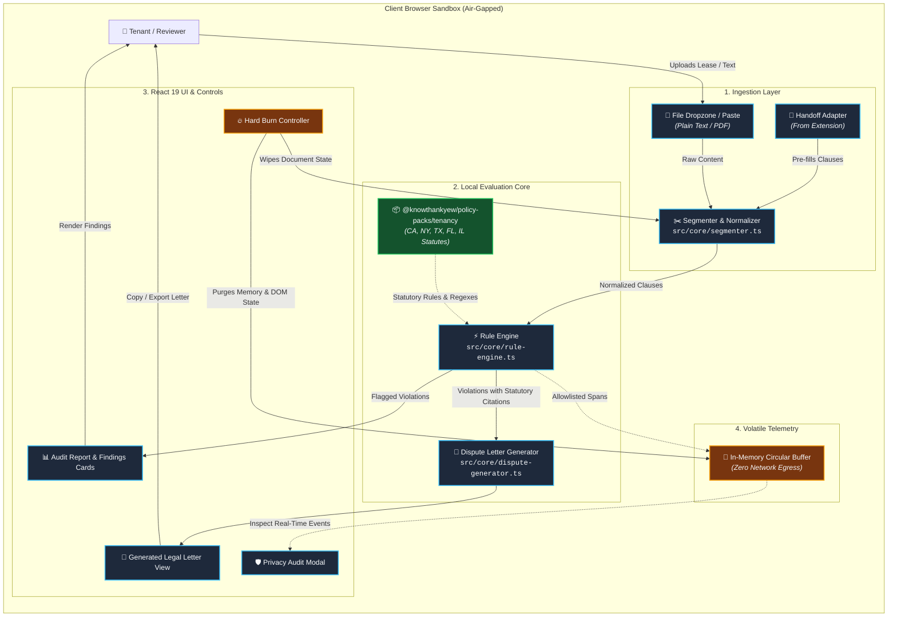
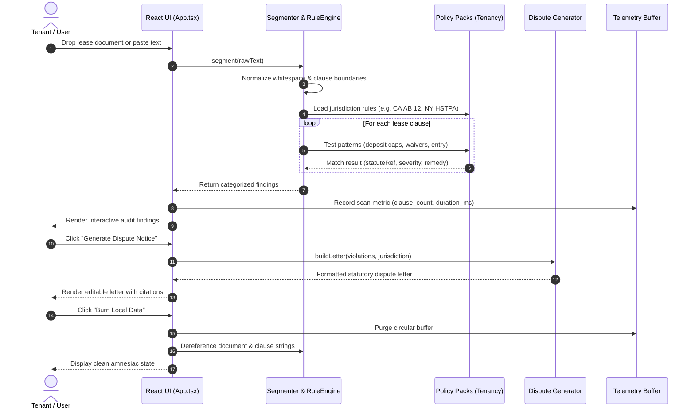

<!-- diagram-meta
  last-validated: 2026-10-26
  validated-commit: 84672cd
  covers: [src/**, contracts/**]
  generated-by: manual
-->

# Architecture & Invariants Specification: Lease Audit Reality Engine

> Client-side residential lease agreement analyzer, statutory clause auditor, and tenant rights dispute generator.

---

## 1. Executive Summary

`lease-audit` is a client-side reality engine in the `knowthankyew` portfolio dedicated to residential lease agreements. It analyzes leases against state statutory protections (such as California AB 12 deposit limits, New York HSTPA, Texas Property Code Ch. 92, and Illinois 765 ILCS), flagging unlawful clauses (e.g., blanket repair waivers, illegal deposit deductions, unauthorized entry clauses, retaliatory eviction waivers) and synthesizing formal tenant dispute letters entirely in client memory.

---

## 2. System Architecture & Component Interactions

### A. Execution Sandbox & Trust Boundary



### B. Audit & Remediation Lifecycle



---

## 3. Core Architectural Invariants

| # | Invariant | Enforcement & Guarantee |
|:--|:----------|:------------------------|
| 1 | **Zero Document Egress** | Leases and PII never leave the client browser. No backend API, analytics beacon, or external storage exists. |
| 2 | **Volatile Memory Telemetry** | Operational events are held strictly in an in-memory ring buffer for the local privacy modal; zero network export in consumer builds. |
| 3 | **Strict Key Allowlists** | Telemetry sanitizes properties against `SAFE_ALLOWLIST_KEYS`; raw lease text, names, and rental addresses are redacted. |
| 4 | **Compile-Time Dead Code Shims** | Enterprise OTLP exporter symbols are dead-code excised at build time in standard consumer builds. |
| 5 | **Amnesiac State Purge (Hard Burn)** | Instantaneous dereferencing and buffer reset returning the application to an uncontaminated initial state. |

---

## 4. Directory Structure

```
lease-audit/
├── docs/
│   ├── ARCHITECTURE.md          # Architecture, data flow & invariant specification
│   ├── PRIVACY_TELEMETRY_SCHEMA.md # Telemetry contract specification
│   └── statutes.md              # Statutory grounding & legal references
├── src/
│   ├── App.tsx                  # Root application view & workflow orchestration
│   ├── main.tsx                 # Entrypoint
│   ├── components/              # UI components (Dropzone, AuditReport, DisputeLetter, BurnModal)
│   ├── contracts/               # TypeScript interfaces & handoff contracts
│   ├── core/
│   │   ├── segmenter.ts         # Document parser & clause boundary detector
│   │   ├── normalizer.ts        # Text normalization & whitespace cleanup
│   │   ├── rule-engine.ts       # Statutory evaluation engine
│   │   ├── dispute-generator.ts # Statutory letter generator citing legal codes
│   │   ├── handoff-adapter.ts   # Structured Handoff from knowthankyew-extension
│   │   └── telemetry.ts         # In-memory privacy telemetry controller
│   └── data/                    # Fallback statutory datasets & sample leases
├── tests/                       # Vitest unit & ReDoS test suites
└── vite.config.ts               # Air-gapped bundler configuration
```
